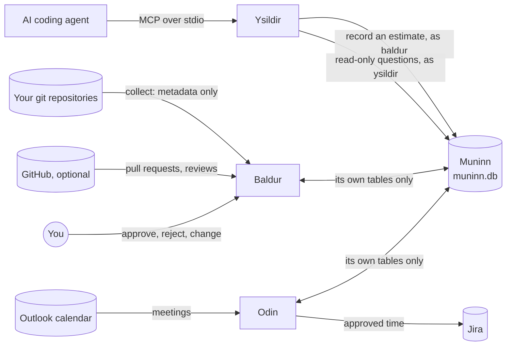

# How Baldur, Ysildir and Muninn work

Oct 11, 2026 · Muninn schema v5 · an explainer, not a contract

These pages explain how the three fit together and why they're built the way they are. The rules themselves live in the contracts and specs, which win if anything here disagrees:

| Page | What it explains | The contract it builds on |
| --- | --- | --- |
| [muninn.md](muninn.md) | The shared database: who may write what, how a write is made, runs, events, upgrades and backups | [muninn-design.md](../muninn-design.md), [muninn-operations.md](../muninn-operations.md) |
| [baldur.md](baldur.md) | From git to an approved figure: collecting, estimating, reviewing, approving, and the AI-assisted method | [baldur-spec.md](../baldur-spec.md), [integration/baldur.md](../integration/baldur.md) |
| [ysildir.md](ysildir.md) | How an AI client uses Asgard through MCP without being able to decide anything | [integration/ysildir.md](../integration/ysildir.md) |

## The three in one paragraph

**Muninn** is one SQLite file per person (`%LOCALAPPDATA%\Asgard\muninn.db`) that every Asgard app reads and writes through the `asgard.muninn` package. **Baldur** reads your git repositories into Muninn, estimates your development time per Jira ticket per day, and lets you approve each figure. **Odin** (not covered here; see [integration/odin.md](../integration/odin.md)) posts approved figures to Jira. **Ysildir** is an MCP server that lets an approved AI coding agent (Kiro, Copilot, Claude Code) tell Baldur how long your change took and ask Muninn questions, but never approve, change or post anything.

## One day, end to end

Here's what happens to a Tuesday's work, in order. Each step links to where it's explained.

1. **You work.** You commit on `feature/PROJ-42-retry` in two repositories and sit in a stand-up and a design review.
2. **An agent reports, if you used one.** After the agent commits with you, its after-commit hook reminds it to record an estimate. It calls Ysildir's `baldur_record_estimate` with its guess at *your* working time on that change and the commits' SHAs. Muninn stores the report as a fact that can't be edited afterwards ([ysildir.md](ysildir.md#recording-an-estimate)).
3. **Odin syncs the calendar.** Your meetings land in Muninn's `calendar_events`. Baldur reads the busy ones through `v_busy_meetings` ([muninn.md](muninn.md#how-the-apps-talk-to-each-other)).
4. **Baldur collects.** On a schedule, or when you press Collect, Baldur reads each repository with the `git` command line: your commits, the HEAD reflog (which records every branch checkout), and the Jira keys each commit belongs to. It never reads code: diffs go through `git patch-id` and only the fingerprint is kept ([baldur.md](baldur.md#1-collecting)).
5. **Baldur estimates.** It builds work sessions from your commits and checkouts, leaves out or weights meeting time, caps each session and the day, splits time across tickets by commit count, and rounds down. Every step can only lower a number ([baldur.md](baldur.md#2-estimating)).
6. **The AI-assisted figures appear beside the estimate.** If an agent reported on that day's commits, Baldur turns the reports into suggested adjustments in plain code (no AI call). Muninn's `check_review` makes sure they can only move time between tickets or lower it, never raise the day ([baldur.md](baldur.md#5-the-ai-assisted-method)).
7. **You review and approve.** In Baldur's window or CLI you see each ticket's figure with the reasoning behind it. You approve the day as it stands, type your own figure for a ticket, take the AI-assisted figures (by the id of exactly the figures you were shown), or reject. A decision, once made, never changes; changing your mind writes a new approval beside the old one ([baldur.md](baldur.md#4-approving)).
8. **Odin posts.** Odin reads `v_worklogs_to_post`, sends each approved figure to Jira as a worklog whose comment ends with a marker like `[asgard:b-9f3c1a2b]`, and records it in `worklogs`. If it crashes mid-post, the marker lets it find the worklog in Jira on the next run instead of posting twice ([muninn.md](muninn.md#how-the-apps-talk-to-each-other)).
9. **Baldur shows what Jira holds.** The day now reads as posted, from `v_day_status`, which compares what you approved with what Odin logged.

Nothing in that chain lets a machine decide a figure: the estimator only lowers numbers, an AI can only suggest, and only you approve.

## Ideas that run through all three

- **Biased low.** A figure becomes time logged against a federal timesheet, so every rule errs low: caps, rounding and the AI checks all go down, and only evidence (a commit, a checkout) can raise a number.
- **You decide.** Approving, rejecting, changing a figure, noting real hours and accepting a calibration are always the person's own acts. No tool, agent or MCP call can do them, and the agent hooks block the commands that would.
- **Metadata only.** Nothing collects or sends code, diffs, commit bodies, Jira descriptions or meeting notes. Muninn holds commit subjects, times, line counts and keys.
- **Facts are kept.** Events, decided proposals, posted worklogs and agent reports can't be edited or deleted. Triggers in the schema enforce it, so a bug in an app can't break it either.
- **Each app writes only its own tables.** Muninn's guard refuses a write to another app's table before it runs. Apps talk through shared views and events, not by writing each other's rows.
- **Standard library at the core.** Muninn and Baldur import no packages, so they work on a locked-down workstation with nothing installed. Ysildir needs the MCP SDK; without it, Baldur's CLI still does everything Ysildir does ([MODULES.md](../../MODULES.md)).

## Where the code is

| Part | Code | Tests |
| --- | --- | --- |
| Muninn | `asgard/muninn/` (`db.py`, `guard.py`, `sync.py`, `baldur.py`, `odin.py`, `integrity.py`, `migrations/`) | `tests/test_muninn*.py` |
| Baldur | `apps/baldur/baldur/` (`collect.py`, `gitread.py`, `estimate.py`, `store.py`, `assist.py`, `desk.py`, `cli.py`), its Qt pages in `apps/baldur/ui/`, agent files in `apps/baldur/agents/` | `tests/test_baldur*.py` |
| Ysildir | `apps/ysildir/ysildir/` (`server.py`, `baldur_tools.py`, `muninn_tools.py`, `teach.py`, `config.py`, `switches.py`), its page in `apps/ysildir/ui/` | `tests/test_ysildir.py` |
