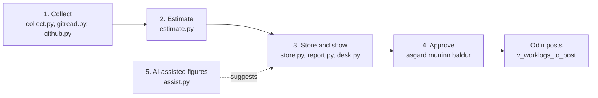

# How Baldur works

Oct 11, 2026 · model `baldur-1`, Muninn schema 4–5 · code in `apps/baldur/baldur/` · the rules are in [baldur-spec.md](../../../docs/baldur-spec.md) and [integration/baldur.md](../integration/baldur.md)

Baldur turns your git history into a proposed figure of development time per Jira ticket per day, shows you how it got each one, and stores the figure you approve. It never writes to Jira; Odin posts what you approve.

The flow has five parts, and each is a separate module so it can be tested on its own:

The window (`apps/baldur/ui/*.qml` over `ui_backend.py`), the CLI (`cli.py`, run as `baldur.cmd`) and Ysildir all call the same functions, so they show the same numbers and follow the same rules. `desk.py` is what the window does, written without any window so it can be tested.

## Before anything: who you are

Baldur refuses to collect or estimate until it knows two things (`collect.check_ready`):

- **Your git emails**, stored as Muninn identities (`asgard baldur setup --email you@agency.gov`). A commit is yours only when it was authored with one of them. Names don't count, because two people can share one.
- **Which Jira projects count** (`project_keys` in `baldur.json`, such as `["PROJ", "OPS"]`; `asgard baldur setup --project PROJ`). A key is `PROJECT-123` whose project is in that list, so `UTF-8`, `SHA-256` and `ISO-8601` are never mistaken for tickets.

## 1. Collecting

`collect.collect()` finds the repositories under your `repo_roots` (at most `max_depth` folders down, never the whole disk) and, for each one, reads git first with no database lock held, then writes everything in one short batch inside a Muninn `Run`.

It reads, with the `git` command line (`gitread.py`):

| What | Why Baldur needs it |
| --- | --- |
| **Your commits** from branches, remote branches, tags and HEAD, with times and line counts | The evidence of work. Not `--all`, which would include stashes and notes |
| **`git patch-id`** fingerprints | A cherry-picked or rebased change is the same work, so it counts once. The diff goes through a pipe from `git log -p` to `git patch-id`, and only the fingerprint is kept |
| **The HEAD reflog** of every working folder | Each `checkout: moving from A to B` line says when you switched to a branch, which is the best evidence of when a session started |
| **Co-authored commits** (a trailer naming one of your emails) | Kept with `is_mine = 0` and shown in the day report, but never counted |

**Jira keys** come from the first source that has any, strongest first (`keys.choose`):

1. **reflog**: the branch you were on when you made the commit, replayed from the reflog;
2. **branch**: the smallest branch that contains the commit and the default branch doesn't (stacked branches contain the ones under them, so the smallest is the most specific);
3. **pr**: the head branch of your pull request that holds the commit (when GitHub is on);
4. **message**: keys in the commit message;
5. **manual**: keys you set with `asgard baldur keys`, which nothing ever overrides.

Weaker evidence never replaces stronger.

A few things are handled specially:

- **Worktrees.** A linked worktree is the same repository as the folder it was added from, so its commits are stored once.
- **Squash copies.** When GitHub squash-merges your pull request, or you `git merge --squash` commits already collected, the copy is stored with `is_merge = 1` and no keys. It's never counted as work. It only ties together the sessions it copies, so they share one session's length limit rather than counting twice.
- **Late commits.** Each collection re-reads `history_days` (default 120) of history, because commits can arrive late from another machine or a rebase.
- **Reflog expiry.** Git expires reflog entries after 90 days, so `asgard baldur schedule` sets up a weekly scheduled task to collect.

**GitHub** is optional (`github.py`) and read-only: Baldur never comments, approves or merges. With a token in Windows Credential Manager it syncs your pull requests, their reviews, and the reviews requested of you. Every list request is conditional on the last ETag, so an unchanged repository costs one request and nothing else.

## 2. Estimating

`estimate.py` is pure functions on plain data, with no git and no database, so every rule is tested directly. It takes commits, checkouts and meetings in and gives minutes per ticket per day out. **Every step can only keep a number or lower it.**

1. **Clean.** Drop duplicates (same patch id) and commits dated in the future.
2. **Build sessions.** Put every commit from every repository on one timeline. A gap longer than `idle_gap_minutes` (120) between commits starts a new session.
3. **Place each session.**
   - It **starts** at the latest checkout onto its first commit's branch, if that was within the idle gap, or else `lead_in_minutes` (30) before its first commit. The reflog alone never creates a session: you have to have committed.
   - It **ends** at its last commit.
   - It's **clamped** to between `min_session_minutes` (15) and `max_session_minutes` (240). A session that's too long keeps the stretch closest to its last commit.
4. **Split at midnight.** A session that crosses local midnight counts toward each day separately.
5. **Account for meetings** by the day's `policy`, using the busy meetings Odin synced:
   - `ambient` (the default): minutes that overlap a meeting count at `ambient_weight` (0.5), since coding through a meeting is partly one and partly the other.
   - `overlap`: the day's cap shrinks by the meeting time, less the `concurrent_fraction` (0.5) you could code through.
   - `independent`: meetings are ignored; the day is flagged if meetings plus development exceed your tour of duty.

   On a day the calendar sync doesn't cover, Baldur can't tell "no meetings" from "not synced", so it uses `independent` and flags the day.
6. **Cap the day.** If the day adds up to more than `max_daily_dev_minutes` (480), every session on it is scaled down to fit, and the day is flagged.
7. **Split across tickets** by commit count. A commit naming two tickets splits evenly. Commit count, not lines changed: a vendored library or a reformat would dwarf an afternoon of debugging in line counts.
8. **Sum and round down** per ticket per day, to `round_to_minutes` (15). Time on commits with no key is "untracked": shown, never approvable.

Each day also carries **flags** saying what Baldur couldn't see: no calendar data, the calendar synced before the day's last work, a reflog that doesn't reach back that far, a weekend day, a squash merge linking sessions.

All the numbers in brackets are defaults in `baldur.json`. **Calibration** (below) fits three of them to your real hours.

## 3. Storing and showing

`store.run()` reads what the estimator needs from Muninn (your commits, checkouts, the busy meetings, which days the calendar covers), runs the estimate, and writes the result in **the same transaction**, so two estimates can't interleave.

What it stores is a `day_proposals` row per day and ticket, each with:

- `minutes_raw` (before rounding) and `minutes_proposed` (rounded down; a CHECK makes sure it's never higher);
- `basis`: the derivation in words, such as which sessions, when they started and why, and the meeting policy. Odin posts it as the worklog comment, so whoever reads the worklog in Jira can see where the number came from;
- `basis_hash`: a fingerprint of the model version, the settings that change numbers, and the sessions behind it.

The hash is what keeps your review list quiet. Re-estimating a day **stores nothing** when the new proposal's hash matches an open, approved or rejected row, or when its number is the one you already decided on, or the one Jira will hold after your approval. A genuinely new proposal **supersedes** the open one for that day and ticket. Approved and rejected rows are never touched.

Each run's settings are copied into `estimate_runs.params`, so changing a setting never changes past numbers.

**What you see is always fresh.** The window and `asgard baldur report` run `store.compute()`, which estimates over Muninn as it is now without writing anything. Approving a day stores that estimate first (writing only what's new), then approves it.

## 4. Approving

Every decision goes through `asgard.muninn.baldur`, which lives beside the schema so the window, the CLI and Ysildir can't take different paths:

| You | Function | What happens |
| --- | --- | --- |
| Approve a day as it stands | `approve_day` | Every open proposal for the day's tickets is approved together, in one transaction, with a `day_proposal.approved` event each |
| Type your own figure for a ticket | `approve_day(minutes={...})` | Your figure replaces that ticket's only. Whole minutes, 0–1,440; a fraction is dropped, because approvals only round down |
| Change an approved figure | `change_approval` | A new approved row, and the old one is superseded. Odin posts only the difference |
| Reject a day | `reject_day` | Every open proposal for the day is rejected |
| Take the AI-assisted figures | `approve_day(take_ai=ID)` | See below |

Decisions are final in the database too: a trigger refuses any edit to an approved or rejected row except approved → superseded. That's why "changing" is a new row, and why the history of what you approved is never lost.

Once approved, a figure appears in Muninn's `v_worklogs_to_post` and Odin posts it on its next run. Baldur reads the result back through `v_day_status` (approved against logged) and `v_unpostable_days` (keys Jira doesn't know, or deleted issues).

## 5. The AI-assisted method

Baldur has two ways to estimate, side by side. The manual engine above uses only git, the calendar and your settings, with no AI. The AI-assisted method (`assist.py`) **suggests figures beside the engine's**. It never replaces them, and you take them or leave them.

An AI-assisted figure comes from one of two places, best first:

1. **A checked AI review.** You (or an agent through Ysildir) send the day's evidence to an approved AI chat, and its JSON answer adjusts the day. This is used while the evidence it saw is still the day's evidence.
2. **Agent estimates.** A coding agent that worked a change with you recorded what it thinks *your* time on that change was (`asgard baldur ai record`, or Ysildir's `baldur_record_estimate`). Baldur turns these reports into adjustments **in code, with no AI call**.

### From agent reports to adjustments

`assist.agent_draft()` does this:

- Each report's figure (its low end, if it gave a range) is shared evenly across the commits it cites, on whatever day. A report covering two days or two tickets splits the way Baldur's own attribution would.
- A report that cites a SHA Baldur hasn't collected, or one matching two of your commits, isn't counted until that's put right, because its split would be a guess. The day's flags say so.
- Where two reports cite one commit, the smaller share counts.
- The targets are then **scaled down, never up**, to fit the minutes the engine proposed for those tickets. An agent can move time between tickets or lower it, but can't raise the day. When an agent says a change took longer than git shows, the day says so and the number stays.

### The gate: check_review

Every suggestion, from an agent or from a review, goes through `muninn.baldur.check_review`. The whole reply is refused if any rule fails:

1. The adjustments sum to zero or less: **the day's total never rises**.
2. Every adjustment names a ticket the day already has, and none goes below zero.
3. Every adjustment cites a commit SHA, session id or report id that was actually in the evidence.
4. At most 10 adjustments, and the results round down again.
5. No ticket goes below what Jira already holds for it that day, because Odin never takes time back out of Jira.

### Taking the figures

The day page shows the AI-assisted figures with a short id: a digest of exactly those figures. Approving with `asgard baldur approve --date 2026-10-01 --ai 3f2a9c1d` takes them **only if they're still the figures you saw**. If a new report has arrived since and changed them, the approval is refused and you look again. The approval records which figure you took, and Odin adds a `Reviewed:` line to the worklog comment.

### Where an AI review can run

| Tier | How | Status |
| --- | --- | --- |
| Clipboard | `asgard baldur ai pack DATE` copies the prompt and the day's evidence; you paste it into an approved AI chat and give the JSON answer to `asgard baldur ai review DATE ANSWER.json` | Works |
| MCP | An agent calls Ysildir's `baldur_review_pack` and `baldur_submit_review` | Built, off by default |
| API | Mímir picks a model and calls it | Not built |

The pack holds commit subjects, times, line counts and keys, never code. `review_mode` in `baldur.json` decides whether a pack may leave the computer at all: `off` (the default) or `metadata`. `content` is refused outright, because Asgard never sends code to an AI tool.

### Agents in your workspace

`asgard baldur ai kiro --into C:\src\my-service` puts two things into a Kiro workspace (`apps/baldur/agents/`):

- a **steering file** that teaches the agent when and how to record an estimate;
- two **hooks**. An after-commit hook reminds the agent to record. A guard hook blocks the agent from running anything that's your decision: `approve`, `reject`, `change`, `actual`, `calibrate --accept`, settings, keys and repositories, the GitHub token, Ysildir's switches, and anything that touches `muninn.db`, `baldur.json` or `ysildir.json`.

## Calibration

The defaults are guesses. Calibration measures them against what really happened (`calibrate.py`):

1. You note your real development time for some days: `asgard baldur actual 2026-10-01 5h30m`. These go in `time_actuals`. Baldur never fits to its own numbers or to your approvals, because an approval usually starts from the estimate and would only confirm it.
2. `asgard baldur calibrate` tries a grid of 270 settings over the three dials the spec names: idle gap (60–180 m), lead-in (0–60 m) and the ambient weight (0.3–0.8). Your current values are always tried too.
3. Only settings that estimate **low on average** may win. Among them, the lowest mean absolute daily error wins. Ties go to the lower estimate, then to the value you already have.
4. Days that can't teach the dials anything are listed and left out: work Baldur can't see, or a day that estimates the same under every setting.
5. `asgard baldur calibrate --accept` (after at least 10 noted days) writes the new settings and records the calibration. Past estimate runs keep the settings they used.

## Settings

`%LOCALAPPDATA%\Asgard\settings\baldur.json`, created with the defaults on first use and editable on the Settings page or with `asgard baldur setup`. A file that won't parse stops every command until it's fixed or deleted: quietly falling back to the defaults could store higher numbers than the ones you chose. Writes go through `asgard.jsonfile`, which writes a temporary file and renames it, retrying when Windows briefly refuses the rename.

## Commands

| Command | What it does |
| --- | --- |
| `setup` | Show or change who you are and what Baldur reads |
| `collect`, `repos` | Read git into Muninn; list repositories or switch one off |
| `estimate`, `report`, `days` | Store proposals; print a day's report with the basis of every number; one line per day |
| `approve`, `reject`, `change` | Your decisions, by proposal id or a whole day (`--ai ID` takes the AI-assisted figures) |
| `keys` | A commit's Jira keys, or set them by hand |
| `actual`, `actuals`, `calibrate` | Note real hours, compare them, fit the dials |
| `ai record`, `list`, `withdraw`, `show` | Agent estimates, and a day's AI-assisted figures |
| `ai pack`, `review` | The clipboard tier of the AI review |
| `ai guide`, `ai kiro` | The agent guide; install steering and hooks into a workspace |
| `github` | Pull requests and review requests (read-only) |
| `schedule` | A weekly scheduled collection (Windows) |
